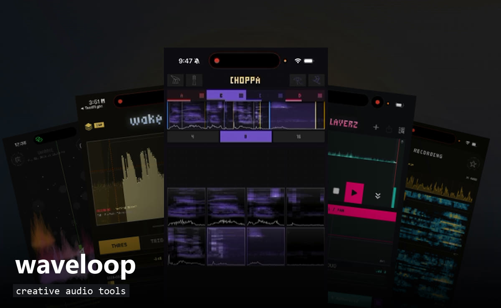
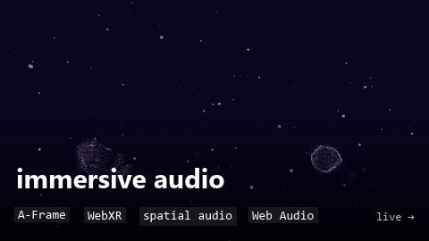
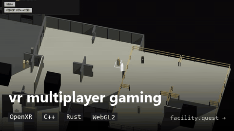
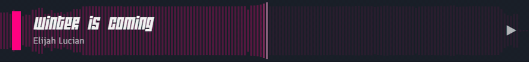
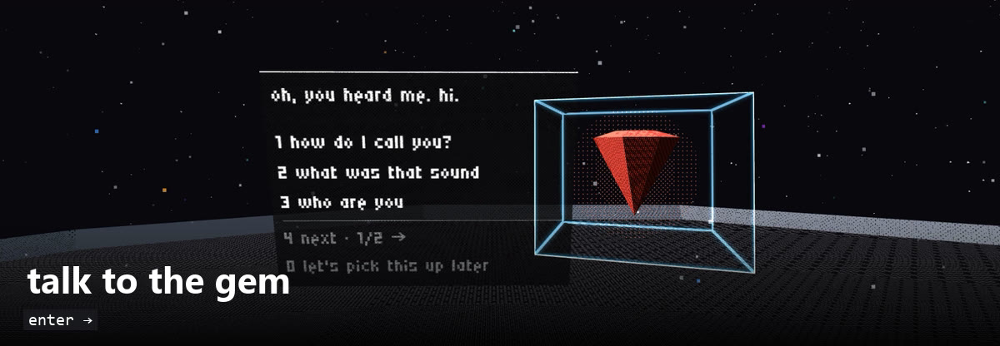

<!--
  MEDIA
  screenshots / gifs: drop into media/ and swap a slot's comment for
    .png" width="100%">
  video: drag the .mp4 into GitHub's web editor; paste the
    https://github.com/user-attachments/assets/... line it gives you
    on its own line (GitHub only plays video from that host)
-->

<!-- BANNER:  -->

<h1 align="center">Elijah Lucian</h1>

  <b>creative technologist</b> 
  code · music · voice — usually for the same project

  
  
  

 

Self-taught, with seventeen years of building across code, music, and visual art. I make generative art systems, audio tools, and tools for coordinating AI agents—all built around my own creative practice.

 

## 〰 WaveLoop

<!-- VIDEO: https://github.com/user-attachments/assets/... -->

 

## ◇ Selected work

 

## ♪ Music

**sketchbook radio** · streaming live 24/7 · [listen for free →](https://eli7vh.github.io/radio/)

## ◎ Voice acting

Games: **AWAKE** · **Stranded Deep** 
Community mods: **Skyrim** · **Fallout: New Vegas**

<!-- VOICE REEL: https://github.com/user-attachments/assets/... -->
