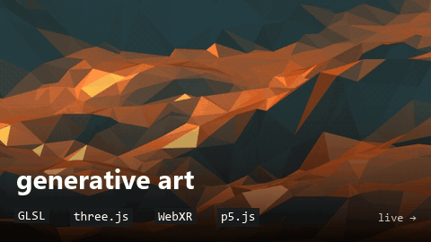
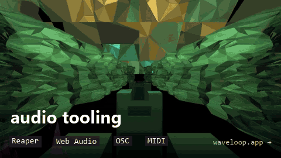
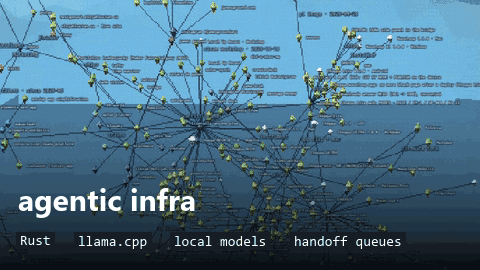
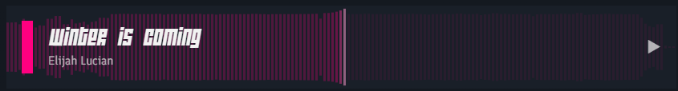

<!--
  MEDIA
  screenshots / gifs: drop into media/ and swap a slot's comment for
    .png" width="100%">
  video: drag the .mp4 into GitHub's web editor; paste the
    https://github.com/user-attachments/assets/... line it gives you
    on its own line (GitHub only plays video from that host)
-->

<!-- BANNER:  -->

<h1 align="center">Elijah Lucian</h1>

  <b>creative technologist</b> 
  code · music · voice — usually for the same project

  
  
  

 

Seventeen years self-taught. Generative art systems, audio tooling, and agentic infrastructure built to run my own creative practice — not someone else's product.

 

## 〰 WaveLoop

[**waveloop.app**](https://waveloop.app) — hit record, hit something, play it.
A family of loopers, samplers and recorders that share one rail: what one app catches, the others can play.

<table>
  <tr><td><b>Choppa</b></td><td>mic sampler that chops itself onto pads</td></tr>
  <tr><td><b>Tide</b></td><td>overdub tape looper, one pass at a time</td></tr>
  <tr><td><b>Layerz</b></td><td>layering looper that hosts AUv3 effects</td></tr>
  <tr><td><b>Wake</b></td><td>wakes on sound, keeps only the sound</td></tr>
  <tr><td><b>infininote</b></td><td>a sketchbook you draw in three dimensions</td></tr>
  <tr><td><b>X1 · X4</b></td><td>tape loopers for Reaper, Mac, Windows, Linux and a Raspberry Pi</td></tr>
</table>

<!-- VIDEO: https://github.com/user-attachments/assets/... -->

 

## ◇ Work

 

## ♪ Music

<table>
  <tr>
    <td><b>James Ground</b></td>
    <td>current</td>
  </tr>
  <tr>
    <td><b>Elijah Lucian</b></td>
    <td><a href="https://eli7vh.github.io/radio/">listen →</a></td>
  </tr>
</table>

## ◎ Voice

**AWAKE** · **Stranded Deep** · **Skyrim** and **New Vegas** community mods

<!-- VOICE REEL: https://github.com/user-attachments/assets/... -->
